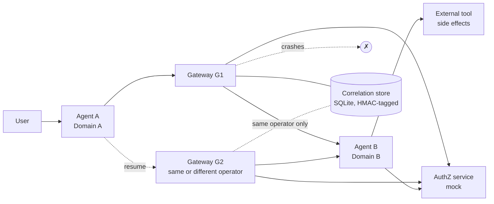

# agentproto-privacy-preserving-dialog-recovery

A small, runnable research prototype that asks one question:

> Can an agent dialog that crosses two administrative domains be resumed
> correctly after the mediator (gateway) in the middle fails, when each domain
> uses its own dialog identifier, i.e. without one identifier that every
> participant can see?

This is an independent experiment intended as input to discussion around the
IETF AgentProto work and
[draft-agentic-ai-usecases-requirements](https://datatracker.ietf.org/doc/draft-agentic-ai-usecases-requirements/)
(revision -03 at the time of writing). It is not an IETF implementation, it
is not endorsed by anyone, and it does not claim compliance with an unfinished
specification.

## Why it matters

The draft requires that dialogs survive interruption (B1-6), that the
resuming party and its authorization are verified (B1-7), and that a dialog
can continue through a different mediator after a failure (B5-2). Its
Security Considerations note that persistent identifiers across domains
enable tracking. These pull in different directions: the simplest way to make
failover work is one identifier everyone shares, which is also the most
linkable. This project measures how far per-domain identifiers get you and
what they cost.

## Short answer from the experiments

* If the replacement gateway is run by the **same operator** and can read the
  failed gateway's durable mapping, per-domain identifiers recover exactly as
  well as a global identifier and the two endpoints share no identifier. This
  needs only local mechanisms.
* If the replacement gateway is run by a **different operator** with no access
  to that state, per-domain identifiers alone cannot recover (0 of 270
  attempts). Recovery worked only when the resumption carried extra material:
  a global id, an opaque ticket sealed by the receiving agent, or a ticket
  sealed by a pre-arranged federation of gateways. Each of these moves
  linkability to some party; none removes it.
* In v0.2.0, no configuration attached a resumption to the wrong dialog, or
  resumed a revoked, expired, terminated, stale or wrong-principal dialog,
  across 1,620 fault-injected attempts — for the faults in the schedule. A
  deliberately guessing gateway (negative control) did so 13 times in 270.
  v0.1.0 made the same claim, but an audit showed both ticket modes accepted
  another dialog's ticket; that fault had not been tested (see below).
* Gateways always link both sides, and event order alone linked the two
  endpoints in 100% of a sequential workload, whatever the identifiers.
* Conclusion: the evidence does **not** show a missing use-case requirement.
  It shows an open protocol-design question — what recovery material an
  independently operated replacement mediator gets — that the protocol and
  architecture work will need to answer. Details:
  [docs/protocol_gap_analysis.md](docs/protocol_gap_analysis.md).

## v0.2.2: Agent A process restart

Scenario suggested by N. Templeman in the AgentProto discussion after he
reviewed v0.2.1 (he has not reviewed v0.2.2): persist an operation as
SENT, restart Agent A in a new OS process from its SQLite ledger before the
acknowledgement is recorded, and let the original downstream execution finish
late. On v0.2.1 this failed in all four tested modes (8 of 8 regression
cases): the restarted agent resent the in-doubt operation when asked to retry
it, and its ledger kept the operation SENT forever, even after the original
execution had committed. v0.2.2:

* marks SENT rows written by a dead Agent A process `IN_DOUBT` (identity,
  payload, attempt and `next_seq` unchanged) and refuses to resend them;
* adds `reconcile_ops()`, which asks Agent B for the authoritative outcome
  (`gateway.resolve_op` → `AgentB.resolve`) and never submits an operation;
  an outcome B cannot yet give stays explicitly unresolved;
* lets B answer NOT_EXECUTED only after fencing every attempt Agent A knows
  about, so a late copy of the original request cannot execute afterwards;
  a retry is an explicit `retry_op()` with the same seq and payload and a new
  attempt number.

This project's own pre-publication technical audit of the first v0.2.2
draft found three issues, now
corrected (72 new test cases, 44 of which failed on the draft): `invoke`
could bypass `retry_op()` and `retry_op()`'s state check was not atomic;
`resolve` could fence or abort attempts without checking authorization; and
some descriptions implied a real Agent B process restart where the tests only
simulate one. See [docs/results.md](docs/results.md#v022-pre-publication-technical-audit).

Results: the regression and 66 acceptance cases pass; the full suite is 379
passed on Python 3.11, 3.12 and 3.13; experiment outputs re-run unchanged.
Safe reconciliation still rests on the external tool's atomic fence (or an
honoured idempotency key), assumption M7. See
[docs/results.md](docs/results.md#agent-a-process-restart-v021--v022).

What this does and does not show. The restart tests use real, separate OS
processes on one host: Agent A is SIGKILLed and a new Agent A process reopens
the same SQLite files, while a separate downstream process (gateways, Agent B,
external tool) keeps running. They do not cover multi-host operation, real
network protocols (the processes talk over a local Unix socket with Python's
`multiprocessing.connection`), clock skew, cross-operator authentication, or
interoperability with any AgentProto specification; none exists yet and none
is claimed.

## v0.2.1: client ledger integrity

A second audit found that Agent A's local operation ledger could overwrite a
COMMITTED operation: a retry that reused a sequence number with a different
payload, or a late error from an older attempt, rewrote the row to
FAILED/UNKNOWN with a NULL result. Reproduced on v0.2.0 (26 of 36 new test
cases failing), fixed with transactional, attempt-aware ledger updates and a
local payload check before dispatch; 44 of 44 pass on v0.2.1. Experiment
outputs were re-run and are unchanged. See
[docs/results.md](docs/results.md#ledger-integrity-repair-v020--v021).

## v0.2.0: audit repair

An independent audit of v0.1.0 reported three defects. All three were
reproduced against the v0.1.0 code before fixing, and the regression tests
pass on v0.2.0 (`tests/test_audit_regressions.py`,
`results/audit_regressions_before_fix.txt`,
`results/audit_regressions_after_fix.txt`). The audit's own report and tests
were not available; the regression tests were written from the defect
descriptions.

1. **Foreign ticket accepted (wrong dialog resumed).** Tickets are now bound
   to the upstream dialog; mismatch returns `TICKET_MISMATCH`. B-sealed
   tickets use a value derived from the upstream id, so B still never learns
   it.
2. **Reconciliation could clear an operation whose tool call was still
   running**, which allowed a second execution. Operations now carry an
   execution lease and incarnation; reconciliation fences the attempt at the
   tool instead of deleting it.
3. **A reused sequence number with a different payload was treated as a
   duplicate.** B now stores a payload digest and returns
   `SEQUENCE_CONFLICT`.

Also corrected: GitHub PR #72 in the draft's repository was merged on
2026-10-09 (v0.1.0 docs said it was still open). Details and what each fix
does and does not cover: [docs/results.md](docs/results.md#audit-repair-v010--v020)
and [CHANGELOG.md](CHANGELOG.md).

## What is implemented



| Piece | Where |
|---|---|
| Agents A and B, external tool | `src/agentproto_recovery/agents.py` |
| Gateways and resumption procedure | `gateways.py`, `recovery.py` |
| Durable correlation store (CAS, leases, HMAC) | `correlation.py`, `persistence.py` |
| Lifecycle state machine | `lifecycle.py` |
| Mock authorization (expiry, revocation, outage) | `authorization.py` |
| Identifiers, HMAC, AES-GCM tickets, log redaction | `security.py` |
| Failure injection, manual clock | `failure_injection.py` |
| Structured JSON events, observer instrumentation | `diagnostics.py` |
| Deployments, scenarios T01-T20, privacy analysis, benchmarks | `evaluation.py` |
| Experiment CLI | `cli.py` |

Six configurations are compared (`global-store`, `global-endpoint`,
`scoped-store`, `scoped-endpoint-noticket`, `scoped-endpoint-ticket`,
`scoped-endpoint-medticket`); see
[docs/architecture.md](docs/architecture.md) for what each one means.

## Install

Requires Python 3.11+. Only runtime dependency: `cryptography`.

```bash
git clone <repository-url> agentproto-privacy-preserving-dialog-recovery
cd agentproto-privacy-preserving-dialog-recovery
python -m venv .venv && . .venv/bin/activate
pip install -e ".[test]"
```

## Run the tests

```bash
pytest
```

Expected: `379 passed` (about 40 s; 74 of these start real OS processes). Each test builds its own deployment in a temporary
directory; tests do not share state.

## Run the experiments

```bash
agentproto-recovery all --out results       # or: python experiments/run_experiments.py
python experiments/render_results.py        # writes results/summary.md
```

Individual parts: `agentproto-recovery scenarios|faults|privacy|benchmark`.
Benchmark only: `python experiments/benchmark.py`. `--help` lists the knobs
(run counts, seeds, dialog counts, threads). About 90 s on a 2-vCPU container.

## Output files

| File | Content |
|---|---|
| `results/scenario_matrix.csv` | one row per scenario × mode: code, recovered, correct association, details |
| `results/scenario_summary.json` | determinism check and incorrect-association counts |
| `results/fault_schedule.csv` | one row per fault-injected recovery attempt |
| `results/fault_summary.json` | per-mode totals and per-fault code counts |
| `results/privacy.json`, `.csv` | linkability metrics per mode |
| `results/benchmark_raw.json` | every run, every statistic |
| `results/benchmark_summary.json`, `.csv` | medians across runs, ratios vs baseline |
| `results/environment_<cmd>.json` | Python, SQLite, platform, arguments, wall time |
| `results/summary.md` | generated Markdown tables |
| `results/audit_regressions_*.txt` | audit regression tests run before and after the v0.2.0 fixes |
| `results/ledger_integrity_*.txt` | ledger-integrity tests run on v0.2.0 (before) and v0.2.1 (after) |
| `results/v0.2.1_rerun_check.txt` | evidence that v0.2.1 reproduces the committed experiment outputs exactly |
| `results/process_restart_before_fix.txt` | restart regression tests on unmodified v0.2.1 (8 failed) |
| `results/process_restart_after_fix.txt` | restart regression and acceptance tests on v0.2.2 (74 passed) |
| `results/v0.2.2_review_before_fix.txt` | technical-audit tests (`test_review_v022.py`) on the first v0.2.2 draft (44 failed, 28 passed) |
| `results/v0.2.2_review_after_fix.txt` | technical-audit tests after the corrections (72 passed) |
| `results/v0.2.2_rerun_check.txt` | evidence that v0.2.2 reproduces the committed experiment outputs exactly |

The committed `results/` are from the run described in
[docs/results.md](docs/results.md).

## Findings

See [docs/results.md](docs/results.md) for numbers and
[docs/protocol_gap_analysis.md](docs/protocol_gap_analysis.md) for the
classification of each finding (protocol information, persistence, local
implementation, policy, security assumption, or simulation limit).

## Relationship to AgentProto requirements

| Requirement (-03) | Exercised by |
|---|---|
| B1-6 dialog continuity and resumption | T03, T04, T15, T16 |
| B1-7 verify participant, termination, authorization on resumption | T09, T10, T11, T13, T19 |
| B3-13 correlation across delegation hops | per-hop mapping in all scoped modes |
| B5-2 continuation through a different mediator | T04, T05, T16, T18, fault schedule |
| B5-3 context across protocol translation | not modelled |
| Sec. 7 persistent identifiers and linkability | T17 / `privacy.json` |

Draft-ready note for the list:
[docs/ietf_contribution_notes.md](docs/ietf_contribution_notes.md).

## Limitations

* The core experiments run in a single process; components call each other
  directly. The v0.2.2 restart tests use separate OS processes on one host
  over a local Unix socket. No HTTP/QUIC binding, no real network partitions,
  no multi-host concurrency.
* Authentication is mocked (the principal is taken as given); Agent B trusts
  the principal relayed by the gateway; one shared mock authorization
  service; one shared clock. See [docs/threat_model.md](docs/threat_model.md).
* Privacy analysis covers identifier equality and one order-based attack on a
  sequential workload. No timing, volume or content analysis. No formal
  privacy guarantee is claimed.
* A crash during establishment leaves an orphan dialog at Agent B; dialog
  lifetime/cleanup is not implemented.
* Safe reconciliation of an unknown side effect assumes the external system
  offers an atomic fence (or honours idempotency keys). The prototype's tool
  was written to provide one; real tools may not.
* The ticket binding stops substitution of another dialog's ticket, but a
  compromised gateway can still mis-route, since it chooses which upstream id
  to derive the binding from.
* Agent A restart recovery (v0.2.2) assumes one live Agent A process per
  ledger file (M9): a SENT row stamped by another process incarnation is
  treated as orphaned. Nothing enforces this; a supervisor must make sure the
  old process is dead before the new one starts.
* Agent B restarts are simulated in the same OS process (a new incarnation
  id while the old executor thread keeps running). Only Agent A restarts are
  real process restarts in the tests.
* Outcome discovery through `resolve` needs only authentication and principal
  binding; aborting or fencing needs a current `invoke` grant. Without one,
  an in-doubt operation stays unresolved and may still complete, once.
* An operation stays explicitly unresolved (IN_DOUBT) for as long as Agent B
  cannot be reached through some gateway that holds the dialog's mapping. In
  `scoped-endpoint-noticket`, if the gateway that carried the operation is
  also gone, that is permanent.
* The fault schedule covers a fixed list of faults; v0.1.0 showed that a
  clean result only covers what is in the list.
* Latency numbers are dominated by SQLite fsync on the test machine and vary
  considerably between runs; they support only coarse comparisons.

## Prior art used

Sealed resumption tickets follow TLS session tickets (RFC 5077; RFC 8446
§4.6.1). Leases follow Gray & Cheriton (SOSP 1989). Epoch/version checks are
ordinary optimistic concurrency control and fencing. Per-request deduplication
with write-ahead intent records is standard practice. None of these
mechanisms is new here; the contribution is the measured comparison.

## License

MIT, see [LICENSE](LICENSE).
