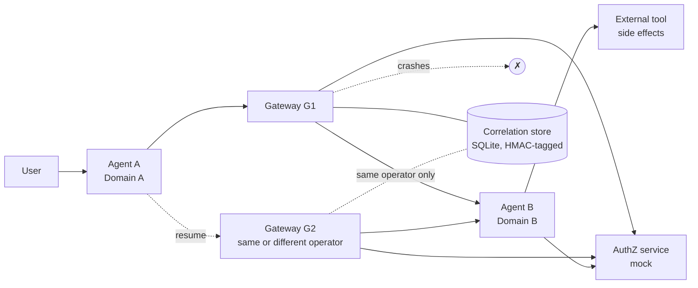

# agentproto-privacy-preserving-dialog-recovery

A small, runnable research prototype that asks one question:

> Can an agent dialog that crosses two administrative domains be resumed
> correctly after the mediator (gateway) in the middle fails, when each domain
> uses its own dialog identifier, i.e. without one identifier that every
> participant can see?

This is an independent experiment intended as input to discussion around the
IETF AgentProto work and
[draft-agentic-ai-usecases-requirements](https://datatracker.ietf.org/doc/draft-agentic-ai-usecases-requirements/)
(revision -03 at the time of writing). It is not an IETF implementation, it
is not endorsed by anyone, and it does not claim compliance with an unfinished
specification.

## Why it matters

The draft requires that dialogs survive interruption (B1-6), that the
resuming party and its authorization are verified (B1-7), and that a dialog
can continue through a different mediator after a failure (B5-2). Its
Security Considerations note that persistent identifiers across domains
enable tracking. These pull in different directions: the simplest way to make
failover work is one identifier everyone shares, which is also the most
linkable. This project measures how far per-domain identifiers get you and
what they cost.

## Short answer from the experiments

* If the replacement gateway is run by the **same operator** and can read the
  failed gateway's durable mapping, per-domain identifiers recover exactly as
  well as a global identifier and the two endpoints share no identifier. This
  needs only local mechanisms.
* If the replacement gateway is run by a **different operator** with no access
  to that state, per-domain identifiers alone cannot recover (0 of 270
  attempts). Recovery worked only when the resumption carried extra material:
  a global id, an opaque ticket sealed by the receiving agent, or a ticket
  sealed by a pre-arranged federation of gateways. Each of these moves
  linkability to some party; none removes it.
* No configuration attached a resumption to the wrong dialog, or resumed a
  revoked, expired, terminated, stale or wrong-principal dialog, across 1,620
  fault-injected attempts. A deliberately guessing gateway (negative control)
  did so 23 times in 270.
* Gateways always link both sides, and event order alone linked the two
  endpoints in 100% of a sequential workload, whatever the identifiers.
* Conclusion: the evidence does **not** show a missing use-case requirement.
  It shows an open protocol-design question — what recovery material an
  independently operated replacement mediator gets — that the protocol and
  architecture work will need to answer. Details:
  [docs/protocol_gap_analysis.md](docs/protocol_gap_analysis.md).

## What is implemented



| Piece | Where |
|---|---|
| Agents A and B, external tool | `src/agentproto_recovery/agents.py` |
| Gateways and resumption procedure | `gateways.py`, `recovery.py` |
| Durable correlation store (CAS, leases, HMAC) | `correlation.py`, `persistence.py` |
| Lifecycle state machine | `lifecycle.py` |
| Mock authorization (expiry, revocation, outage) | `authorization.py` |
| Identifiers, HMAC, AES-GCM tickets, log redaction | `security.py` |
| Failure injection, manual clock | `failure_injection.py` |
| Structured JSON events, observer instrumentation | `diagnostics.py` |
| Deployments, scenarios T01-T20, privacy analysis, benchmarks | `evaluation.py` |
| Experiment CLI | `cli.py` |

Six configurations are compared (`global-store`, `global-endpoint`,
`scoped-store`, `scoped-endpoint-noticket`, `scoped-endpoint-ticket`,
`scoped-endpoint-medticket`); see
[docs/architecture.md](docs/architecture.md) for what each one means.

## Install

Requires Python 3.11+. Only runtime dependency: `cryptography`.

```bash
git clone <repository-url> agentproto-privacy-preserving-dialog-recovery
cd agentproto-privacy-preserving-dialog-recovery
python -m venv .venv && . .venv/bin/activate
pip install -e ".[test]"
```

## Run the tests

```bash
pytest
```

Expected: `181 passed`. Each test builds its own deployment in a temporary
directory; tests do not share state.

## Run the experiments

```bash
agentproto-recovery all --out results       # or: python experiments/run_experiments.py
python experiments/render_results.py        # writes results/summary.md
```

Individual parts: `agentproto-recovery scenarios|faults|privacy|benchmark`.
Benchmark only: `python experiments/benchmark.py`. `--help` lists the knobs
(run counts, seeds, dialog counts, threads). About 90 s on a 2-vCPU container.

## Output files

| File | Content |
|---|---|
| `results/scenario_matrix.csv` | one row per scenario × mode: code, recovered, correct association, details |
| `results/scenario_summary.json` | determinism check and incorrect-association counts |
| `results/fault_schedule.csv` | one row per fault-injected recovery attempt |
| `results/fault_summary.json` | per-mode totals and per-fault code counts |
| `results/privacy.json`, `.csv` | linkability metrics per mode |
| `results/benchmark_raw.json` | every run, every statistic |
| `results/benchmark_summary.json`, `.csv` | medians across runs, ratios vs baseline |
| `results/environment_<cmd>.json` | Python, SQLite, platform, arguments, wall time |
| `results/summary.md` | generated Markdown tables |

The committed `results/` are from the run described in
[docs/results.md](docs/results.md).

## Findings

See [docs/results.md](docs/results.md) for numbers and
[docs/protocol_gap_analysis.md](docs/protocol_gap_analysis.md) for the
classification of each finding (protocol information, persistence, local
implementation, policy, security assumption, or simulation limit).

## Relationship to AgentProto requirements

| Requirement (-03) | Exercised by |
|---|---|
| B1-6 dialog continuity and resumption | T03, T04, T15, T16 |
| B1-7 verify participant, termination, authorization on resumption | T09, T10, T11, T13, T19 |
| B3-13 correlation across delegation hops | per-hop mapping in all scoped modes |
| B5-2 continuation through a different mediator | T04, T05, T16, T18, fault schedule |
| B5-3 context across protocol translation | not modelled |
| Sec. 7 persistent identifiers and linkability | T17 / `privacy.json` |

Draft-ready note for the list:
[docs/ietf_contribution_notes.md](docs/ietf_contribution_notes.md).

## Limitations

* Single process; components call each other directly. No HTTP/QUIC binding,
  no real network partitions, no multi-host concurrency.
* Authentication is mocked (the principal is taken as given); Agent B trusts
  the principal relayed by the gateway; one shared mock authorization
  service; one shared clock. See [docs/threat_model.md](docs/threat_model.md).
* Privacy analysis covers identifier equality and one order-based attack on a
  sequential workload. No timing, volume or content analysis. No formal
  privacy guarantee is claimed.
* A crash during establishment leaves an orphan dialog at Agent B; dialog
  lifetime/cleanup is not implemented.
* Latency numbers are dominated by SQLite fsync on the test machine and vary
  considerably between runs; they support only coarse comparisons.

## Prior art used

Sealed resumption tickets follow TLS session tickets (RFC 5077; RFC 8446
§4.6.1). Leases follow Gray & Cheriton (SOSP 1989). Epoch/version checks are
ordinary optimistic concurrency control and fencing. Per-request deduplication
with write-ahead intent records is standard practice. None of these
mechanisms is new here; the contribution is the measured comparison.

## License

MIT, see [LICENSE](LICENSE).
