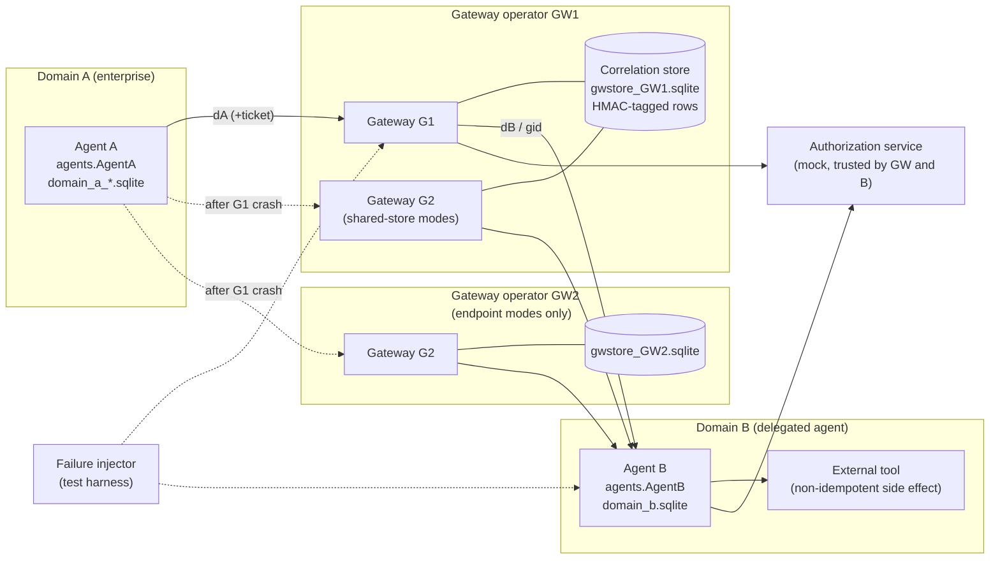
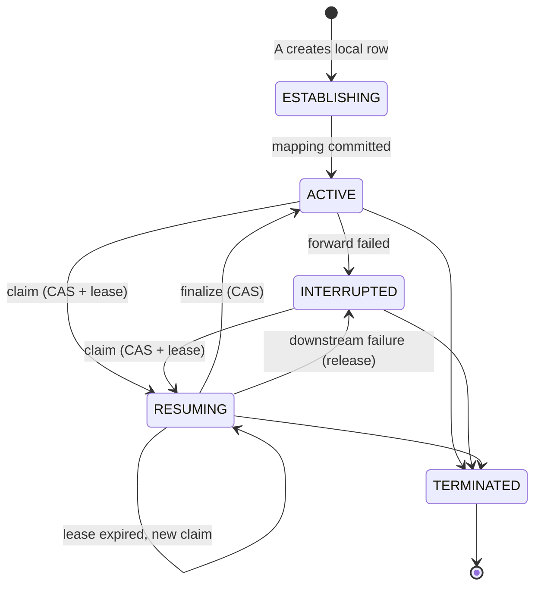

# Architecture

This document describes what the prototype implements. Every component named
here is a Python class in `src/agentproto_recovery/`. All components run in a
single process and talk through method calls; "messages" are function
arguments. There is no network stack (see Limitations in the README).

## Participants and administrative domains



| Component | Module | Domain | Durable state |
|---|---|---|---|
| Agent A | `agents.AgentA` | A | its own dialogs, epoch, ticket, pending resume id, op ledger |
| Agent B | `agents.AgentB` | B | its own dialogs, epoch, op ledger, resume log; ticket key |
| External tool | `agents.ExternalTool` | B | append-only execution log |
| Gateway G1/G2/G3 | `gateways.Gateway` | gateway operator | correlation store (`correlation.CorrelationStore`) |
| Authorization service | `authorization.AuthorizationService` | external, mock | in-memory grants |
| Failure injector | `failure_injection.FailureInjector` | harness | none |
| Evaluation harness | `evaluation.Deployment`, `cli` | harness | result files |

Each domain has its own SQLite file. No component reads another domain's
file. The only shared file is the gateway store in the `*-store` modes, where
G1 and G2 belong to the *same* operator; that sharing is the deployment
assumption being tested, not a shortcut.

## Identifier schemes and recovery configurations

| Mode | Identifier seen by A | by B | Replacement gateway G2 | Recovery material G2 uses |
|---|---|---|---|---|
| `global-store` | gid | gid | same operator, reads G1's store | stored mapping |
| `global-endpoint` | gid | gid | independent operator, own empty store | the gid presented by A |
| `scoped-store` | dA | dB | same operator, reads G1's store | stored mapping dA→dB |
| `scoped-endpoint-noticket` | dA | dB | independent operator | nothing (expected to fail) |
| `scoped-endpoint-ticket` | dA | dB | independent operator | opaque ticket sealed by **Agent B** (AES-GCM, key only B holds), carried by A, forwarded unopened |
| `scoped-endpoint-medticket` | dA | dB | independent operator | opaque ticket sealed by **G1** with a key pre-shared among cooperating gateway operators; G2 opens it, B never sees it |

All identifiers are 128 bits from `secrets.token_urlsafe` (OS CSPRNG).
Gateways always see both dA and dB; that is inherent to forwarding.

Operation sequence numbers (`seq`, 1, 2, 3 per dialog) cross all hops in every
mode. They are low-entropy and identical across dialogs, so they were chosen
over random per-operation ids, which would be a cross-domain join key. Their
residual linkage value was not measured.

## Dialog lifecycle

Gateway-side record (`lifecycle.State`):



`check_transition` rejects any other transition; `TERMINATED` is absorbing.

Agent B keeps its own `state` (ACTIVE / TERMINATED) and an integer `epoch`
that increases by one on every successful resumption. B is authoritative for
both.

## Resumption after failover (scoped-store)

```mermaid
sequenceDiagram
    participant A as Agent A (Domain A)
    participant G2 as Gateway G2 (GW1)
    participant S as Store (GW1)
    participant Z as AuthZ
    participant B as Agent B (Domain B)
    A->>G2: Resume(dA, epoch_seen, request_id[, ticket])
    G2->>S: get(tenant, dA); verify HMAC tag
    G2->>G2: principal binding, not TERMINATED
    G2->>Z: check(principal, tenant, "resume")
    G2->>G2: same request_id? return cached result
    G2->>G2: epoch_seen == stored epoch?
    G2->>S: CAS: state=RESUMING, owner=G2, lease
    G2->>B: Resume(dB, expected_epoch)
    B->>B: principal/tenant binding, not TERMINATED
    B->>Z: check(principal, tenant, "resume")
    B->>B: CAS epoch e -> e+1 (or replay of e -> e+1)
    B-->>G2: OK(epoch e+1[, new ticket])
    G2->>S: CAS: state=ACTIVE, epoch=e+1, cache result
    G2-->>A: OK(epoch e+1[, new ticket])
```

The full ordered check list is in the docstring of `recovery.py`. Any failed
check ends the attempt with an explicit `Code` (`errors.py`). There is no code
path that selects a dialog by task content or by "most recent" heuristics,
except the `unsafe_guess_on_missing` flag, which exists only as a negative
control for the evaluation oracle.

## What Gateway G2 needs in order to recover

From the code and the T04/T05/T16 results:

1. A way to find the downstream dialog for the upstream reference A presents:
   a readable mapping (store modes), an end-to-end identifier (global modes),
   or an opaque ticket that someone downstream of A can open (ticket modes).
   Without one of these G2 returns `MAPPING_NOT_FOUND`
   (`scoped-endpoint-noticket`, 100% of attempts in the fault schedule).
2. The principal and tenant the dialog is bound to (in the store row or inside
   the ticket), to reject resumption by another principal (T11).
3. The current epoch, to reject stale or rolled-back references (T08, T12b).
4. Access to the authorization service, independently of 1-3 (T09, T10, T13).
5. For store modes, the ability to take a lease-protected claim so that two
   replacement gateways do not both finalize (T16, T18).

G2 does **not** need A's or B's task context, the operation history, or the
external tool's state. Duplicate side effects are prevented at B by
`(dialog, seq)` deduplication and a write-ahead intent row (T14, T14b).

## Storage contracts

* `correlation` (gateway): primary key `(tenant, upstream_id)`. Every row has
  an HMAC-SHA256 tag over all other columns. All updates are compare-and-set
  on `version` inside `BEGIN IMMEDIATE`. `restore_checkpoint` refuses an older
  version. Integrity is not freshness: a validly tagged old row passes the
  tag check (T12b).
* `dialogs` / `resume_log` / `ops` (Agent B): epoch transitions are
  `UPDATE ... WHERE epoch = expected` inside a transaction. `resume_log`
  keyed by `(dialog_id, from_epoch)` lets B answer a repeat of its most recent
  transition without advancing again. `ops` gets a `PENDING` row committed
  *before* the external call and `COMMITTED` after.
* SQLite runs in WAL mode with `synchronous=FULL`.

## Invariants

| Invariant | Mechanism | Evidence | Status |
|---|---|---|---|
| I1 Never associate unrelated dialogs | lookup only by `(tenant, id)`, HMAC-tagged mapping, AEAD tickets, no content matching | T06, T07, T12, fault schedule: 0 incorrect associations in 1,620 attempts across 6 modes; negative control produces 23 | Demonstrated for the tested faults; not proven in general |
| I2 Correlation is not authorization | separate `authz.check` at gateway and at B | T09, T10, T13, `test_valid_mapping_is_not_authorization`, `test_b_enforces_authz_even_if_gateway_skipped_it` | Demonstrated |
| I3 Never silently resume a terminated dialog | state check at gateway and B, `TERMINATED` absorbing | T19, fault schedule `terminated` | Demonstrated |
| I4 Never overwrite newer state with an older checkpoint | CAS on version / epoch, `restore_checkpoint` | `test_older_checkpoint_cannot_overwrite_newer_state`, T08, T12b | Demonstrated for the store and B; Agent A's own local DB is not protected (test helper `_force_local` rolls it back on purpose) |
| I5 Never claim success without mandatory state | every missing piece maps to a non-OK code | T05, T13, T16b, T20 | Demonstrated |
| I6 Never repeat a side effect because a response was lost | `(dialog, seq)` dedup, write-ahead `PENDING`, `OUTCOME_UNKNOWN` + reconciliation | T14, T14b, `test_reconcile_when_tool_never_ran` | Demonstrated in-process; a crash *inside* the tool call that leaves the tool's own state ambiguous is modelled only by `ExternalTool.lookup` |
| I7 One epoch transition per resumption, even under races | CAS at B, lease + CAS at gateway | T16, T18, 8-way race test | Demonstrated with threads in one process; not tested across processes or hosts |

Unproven: behaviour under real network partitions, clock skew between
gateways (leases use one shared `ManualClock`), multi-process SQLite
contention beyond a single host, and adversaries who hold the gateway's HMAC
key.
